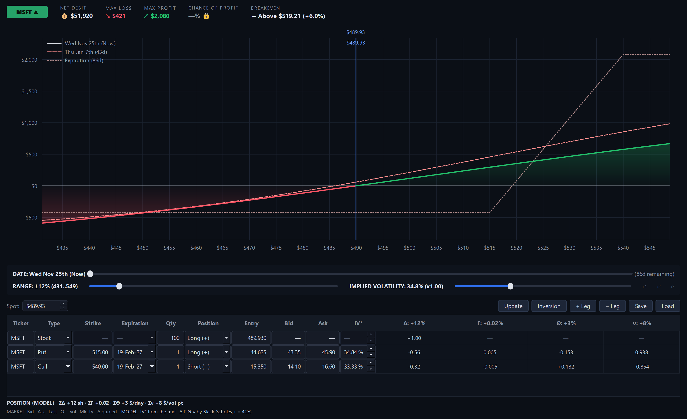
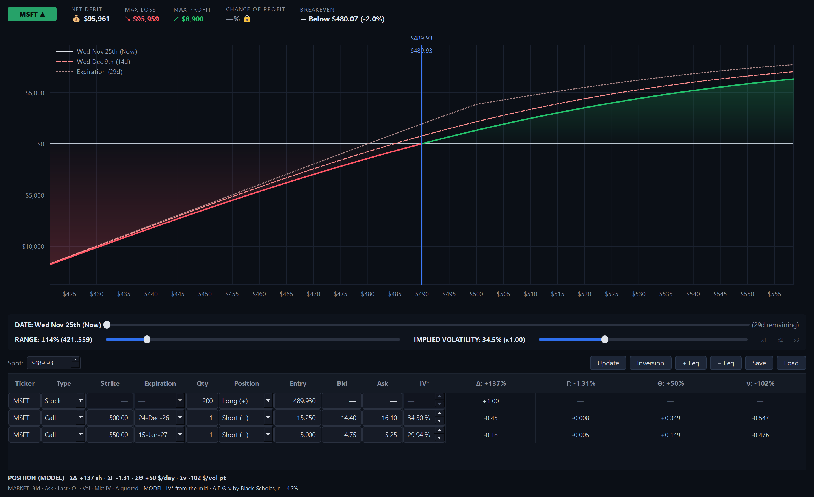
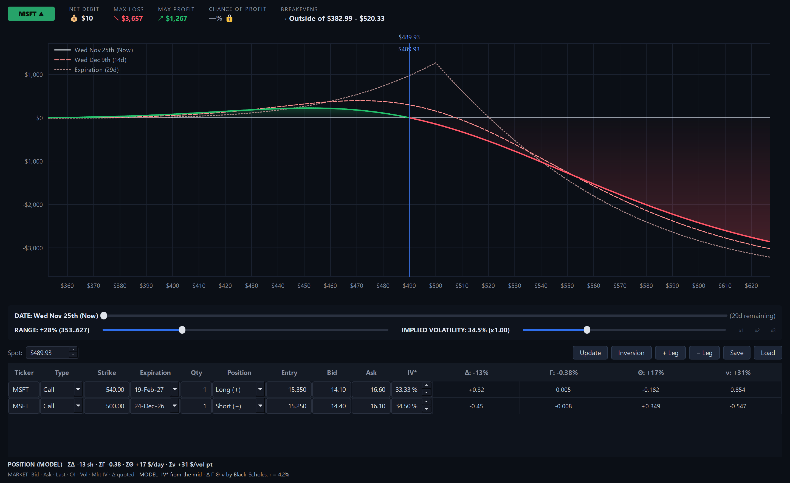

# Options Strategy Analytics

Interactive P/L profile chart for multi-leg option strategies, built with PyQt5.



## Background

This repository is a small, distilled module extracted from **QC Assistant**, a
larger C++ application for deep analysis of option models and complex outcome
scenarios. It is not that application: only the strategy-visualization part is
here, rewritten in Python and PyQt5. It does not provide the full analytical
depth of QC Assistant. What it provides is a focused view: the P/L profile,
breakevens and per-leg greeks of a single multi-leg position.

## What it does

- Long and short calls, puts and stock legs, each with its own expiration.
- Today's curve and curves up to expiration, priced with Black-Scholes.
- Per-leg implied volatility solved from the entry premium at the current spot.
- IV slider that scales every leg while keeping the skew.
- Greek columns (delta, gamma, theta, vega) for each leg at the selected date;
  the header carries the position total, e.g. `Δ:+12% Γ:+0.02%`, below the
  POSITION (MODEL) line with the same sums and their units (ΣΔ shares,
  ΣΓ Δ per $1, ΣΘ $/day, Σν $/vol pt).
- Bid and ask are kept exactly as quoted in the snapshot; IV* and the greeks
  are model output, so market and model values never mix.
- Portfolios saved and loaded as JSON, including the valuation date and the
  quoted snapshot.
- Update button: bid/ask from Yahoo Finance, IVs re-solved from the mid.
- Inversion flips the whole position long <-> short.
- Net debit/credit, max loss, max profit and breakevens with cents.

## Demo portfolios

`portfolios/` holds three historical demonstration snapshots of MSFT quoted on
**25 Nov 2026** by Optionistics / HistoricalOptionData, spot **$489.93**.
Option prices are per share; entry is the bid/ask midpoint. The sizes are small
on purpose: 1,000 shares against 10 contracts where the structure is written on
stock, 1:1 between option legs. They are historical demonstrations, not trading
recommendations, and some of the contracts are thinly traded.

| Portfolio | Structure | Net | Max loss | Max profit |
|-----------|-----------|-----|----------|------------|
| [MSFT Equity Collar](portfolios/msft-collar.json) | +1,000 shares, +10 × 515P, −10 × 540C, 19-Feb-27 | debit $519,205 | $4,205 | $20,795 |
| [MSFT Covered Call Ladder](portfolios/msft-covered-call-ladder.json) | +1,000 shares, −5 × 500C 24-Dec-26, −5 × 550C 15-Jan-27 | debit $479,805 | $479,795 | $44,500 |
| [MSFT Call Diagonal](portfolios/msft-call-diagonal.json) | +10 × 540C 19-Feb-27, −10 × 500C 24-Dec-26 | debit $100 | $36,570 | $12,669 |

Each is one working idea rather than a position with history:

- **Equity collar** — a floor above the spot and a cap at 540. The worst case is
  −0.8% of the position, the best +4.0%; the protection costs 6% of the stock
  value.
- **Covered call ladder** — half the book is written in December at 500, half in
  January at 550: $10,125 of credit (2.1%) for capping part of the upside. The
  downside stays with the stock.
- **Call diagonal** — sells the front 500 call quoted at 34.6% IV and owns the
  back 540 call at 32.7% for $100. Profit if MSFT ends below roughly 520 in
  December; the loss is capped when the stock runs above 540.





Load one from the command line or with the Load button:

```
option_profile.py --portfolio portfolios/msft-collar.json
```

The file format is plain JSON: `name`, `valuation_date`, `spot`, `source`, then
one entry per leg with `kind` (`C`, `P`, `S`), `strike`, `expiry`, `qty`, `side`,
`entry` and, when known, `bid`, `ask`, `last`, `iv` (percent), `volume`, `oi` and
the quoted `delta`. The optional `view` block restores the chart range, the IV
slider, the selected day and the cursor.

## Requirements

Python 3.8+ and PyQt5. `yfinance` is optional and is only used by the Update
button.

```
pip install -r requirements.txt
```

## Running

```
python option_profile.py
python option_profile.py --selftest    # 41 checks, no GUI, no network
```

The window takes a few preset flags for quick demo setups:

```
python option_profile.py --portfolio portfolios/msft-collar.json
python option_profile.py --diagonal --spot 353.23 --range 28 --iv 101 --days 0 --mid-days 7 --center-spot
```

| Flag | Meaning |
|------|---------|
| `--portfolio PATH` | load a portfolio file (legs, spot, valuation date) |
| `--diagonal` | load the double diagonal preset |
| `--spot X` | underlying price |
| `--range P` | chart range, percent around the center |
| `--iv X` | IV multiplier, 100 = 1.00x |
| `--days N` | date slider, days from the valuation date |
| `--mid-days N` | dashed middle curve, N days before the nearest expiry |
| `--center-spot` | center the x-axis on the spot instead of the strikes |

## Pricing model

- Black-Scholes with a fixed rate of 4.2%.
- Each leg's implied vol is solved from its entry premium at the current spot
  (bisection), so the "now" curve passes through zero at the spot.
- After expiration an option is worth its intrinsic value.
- One option contract is 100 shares; a stock leg counts shares directly and
  has a delta of 1 per share. The position's total delta is shown in shares
  in the POSITION (MODEL) line.
- Max loss, max profit and breakevens are evaluated at the nearest option
  expiry of the position.

## Market data and model output

The legs table keeps both kinds of numbers apart. Bid and ask come from the
snapshot as received and are never overwritten by the model; the rest of the
quoted snapshot (last, open interest, volume, market IV, quoted delta) stays in
the JSON file and in the tooltips. IV* and the greek columns are recomputed
from Black-Scholes at the selected date. A loaded portfolio also keeps its own
valuation date, so the chart is drawn as of the day the quotes were taken.

## Notes and limitations

- This is not a full analytics platform, only the P/L profile and greeks of one
  position (see Background).
- Yahoo quotes are unofficial, delayed and may be missing outside market hours;
  Update falls back to the last price.
- Chance of profit is not calculated and is shown as a placeholder.
- The 4.2% rate is an assumption, not a live curve.
- Educational tool, not trading advice.

## Roadmap

This module will become the strategy-visualization layer of a larger order-flow
application backed by a database.

## License

Proprietary, all rights reserved. The source is published for viewing only.
Use in other projects, modification, redistribution and commercial use require
prior written permission from the author. See [LICENSE](LICENSE).
